# Diagrama entidad-relación de la base de datos (CONTATECK)

**Fuente:** esquema real del proyecto `contateck-dev` leído de Supabase el 25-nov-2026 con consultas de solo lectura (tablas, columnas y llaves foráneas). Son **25 tablas** del esquema `public` (más 2 vistas de saldos: `cfdis_saldo` y `cfdis_proveedor_saldo`); todas tienen RLS activo.
Para no saturar el dibujo se muestran los atributos principales y se omiten las llaves foráneas "quién lo creó" hacia `perfiles` (`created_by`, `creado_por`, `confirmado_por`…) y la relación de cada tabla con `auth.users` de Supabase.

Los diagramas están en Mermaid: se ven directamente en GitHub y en VS Code (con la extensión de Mermaid), o se pueden pegar en https://mermaid.live para exportarlos como imagen para el informe.

## 1. Diagrama completo

```mermaid
erDiagram
    empresas ||--o{ perfiles : "tiene usuarios"
    roles ||--o{ perfiles : "rol del usuario"
    empresas ||--o{ usuario_empresas : "membresias"
    perfiles ||--o{ usuario_empresas : "pertenece a"
    roles ||--o{ usuario_empresas : "rol en la empresa"
    empresas ||--o{ invitaciones : "invita"
    roles ||--o{ invitaciones : "rol ofrecido"

    empresas ||--o{ clientes : "tiene"
    empresas ||--o{ productos : "tiene"
    empresas ||--o{ empleados : "tiene"

    empresas ||--o{ cuentas_contables : "catalogo"
    empresas ||--o{ polizas : "registra"
    polizas ||--o{ poliza_partidas : "partidas Debe y Haber"
    cuentas_contables ||--o{ poliza_partidas : "se carga o abona"
    polizas ||--o{ polizas : "corrige o anula (ajuste_de_id)"
    empresas ||--|| configuracion_contable : "cuentas por rol"
    cuentas_contables ||--o{ configuracion_contable : "bancos, clientes, ventas, IVA..."
    empresas ||--o{ periodos_contables : "abiertos o cerrados"
    empresas ||--o{ folios_contador : "consecutivos"

    empresas ||--o{ cfdis : "emite"
    clientes ||--o{ cfdis : "receptor"
    cfdis ||--o{ pagos_cliente : "cobros"
    polizas ||--o| pagos_cliente : "poliza del cobro"
    cuentas_contables ||--o{ pagos_cliente : "cuenta destino"

    empresas ||--o{ cfdis_proveedor : "recibe"
    polizas ||--o| cfdis_proveedor : "poliza de causacion"
    cfdis_proveedor ||--o{ pagos_proveedor : "pagos"
    polizas ||--o| pagos_proveedor : "poliza del pago"
    cuentas_contables ||--o{ pagos_proveedor : "cuenta origen"

    empresas ||--o{ ventas : "pagos recibidos"
    polizas ||--o| ventas : "poliza de la venta"

    empresas ||--o{ nominas : "procesa"
    nominas ||--o{ nomina_detalle : "detalle por empleado"
    empleados ||--o{ nomina_detalle : "se paga a"

    empresas ||--o{ obligaciones_fiscales : "configura"
    obligaciones_fiscales ||--o{ declaraciones : "declaraciones por periodo"
    empresas ||--o{ documentos_fiscales : "guarda"
    empresas ||--o{ auditoria_log : "bitacora"

    empresas {
        uuid id PK
        text nombre
        text rfc
        text regimen_fiscal
    }
    perfiles {
        uuid id PK
        uuid empresa_id FK
        uuid rol_id FK
        text nombre
        text email
    }
    roles {
        uuid id PK
        text nombre
    }
    usuario_empresas {
        uuid user_id FK
        uuid empresa_id FK
        uuid rol_id FK
        bool activo
    }
    invitaciones {
        uuid id PK
        text correo
        text estado
        uuid token
    }
    clientes {
        uuid id PK
        text nombre
        text rfc
    }
    productos {
        uuid id PK
        text descripcion
        text clave_prod_serv
        numeric precio_unitario
    }
    empleados {
        uuid id PK
        text nombre
        numeric sueldo
        text estado
    }
    cuentas_contables {
        uuid id PK
        text codigo
        text nombre
        text naturaleza
        text codigo_agrupador
    }
    polizas {
        uuid id PK
        text folio
        text tipo
        date fecha
        text estado
        text cfdi_uuid
    }
    poliza_partidas {
        uuid id PK
        uuid poliza_id FK
        uuid cuenta_id FK
        numeric debe
        numeric haber
    }
    configuracion_contable {
        uuid empresa_id PK
        uuid cuenta_bancos_id FK
        uuid cuenta_clientes_id FK
        uuid cuenta_iva_trasladado_id FK
    }
    periodos_contables {
        uuid id PK
        int anio
        int mes
        text estado
    }
    folios_contador {
        uuid empresa_id PK
        text tipo
        int ultimo_numero
    }
    cfdis {
        uuid id PK
        text uuid_sat
        text folio
        text tipo
        numeric total
        text estatus
    }
    pagos_cliente {
        uuid id PK
        uuid cfdi_id FK
        numeric monto
        text estado
    }
    cfdis_proveedor {
        uuid id PK
        text uuid_sat
        numeric total
        uuid poliza_causacion_id FK
    }
    pagos_proveedor {
        uuid id PK
        uuid cfdi_proveedor_id FK
        numeric monto
        text estado
    }
    ventas {
        uuid id PK
        text folio
        numeric importe
        text estado
        uuid poliza_id FK
    }
    nominas {
        uuid id PK
        text periodicidad
        numeric total_neto
    }
    nomina_detalle {
        uuid id PK
        uuid nomina_id FK
        uuid empleado_id FK
        numeric neto
    }
    obligaciones_fiscales {
        uuid id PK
        text nombre
        text periodicidad
        int2 dia_limite
    }
    declaraciones {
        uuid id PK
        uuid obligacion_id FK
        text periodo
        date fecha_vencimiento
        text estado
    }
    documentos_fiscales {
        uuid id PK
        text tipo
        date vigencia_hasta
    }
    auditoria_log {
        uuid id PK
        text tabla_afectada
        text accion
        jsonb detalle
    }
    administradores_plataforma {
        uuid user_id PK
        text nivel
    }
```

## 2. Lectura del diagrama
- **Multiempresa:** casi todas las tablas llevan `empresa_id`, y la política RLS compara ese campo con la empresa del usuario (`auth_empresa_id()`), de modo que cada empresa solo ve lo suyo. `usuario_empresas` permite que una persona pertenezca a más de una empresa con rol distinto en cada una.
- **Contabilidad:** una **póliza** tiene varias **partidas** (Debe y Haber contra cuentas del **catálogo**). Una corrección o anulación no borra: crea una póliza que apunta a la original (`ajuste_de_id`). `configuracion_contable` dice qué cuenta usa el sistema para bancos, clientes, proveedores, ventas, IVA trasladado, IVA acreditable y gastos.
- **Ligas con el SAT:** `polizas.cfdi_uuid` liga la póliza de causación con el CFDI emitido; `cfdis_proveedor.poliza_causacion_id` hace lo mismo para facturas de proveedor. `cuentas_contables.codigo_agrupador` guarda el Código Agrupador del SAT.
- **Cobranza y pagos:** `pagos_cliente` y `pagos_proveedor` nacen "registrados" y al confirmarse generan su póliza (`poliza_id`).
- **Administración de la plataforma:** `administradores_plataforma` no tiene políticas de lectura para usuarios normales (solo se usa desde el panel de plataforma).
- **Vistas:** `cfdis_saldo` y `cfdis_proveedor_saldo` calculan el saldo pendiente de cada factura (total menos pagos confirmados).
