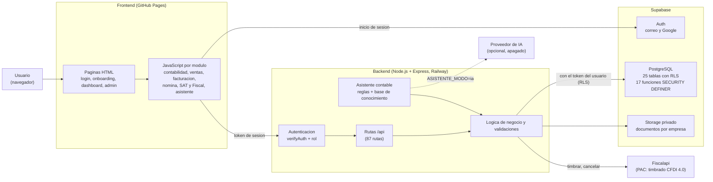
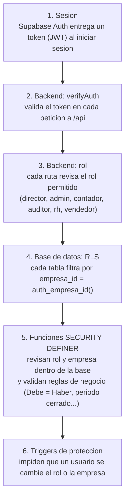

# Arquitectura y capas de seguridad (CONTATECK)

Los diagramas están en Mermaid (se ven en GitHub y en VS Code; para el informe se pueden exportar como imagen desde https://mermaid.live).

## 1. Arquitectura general

## 2. Capas de seguridad (defensa en profundidad)

**Principios aplicados** (comprobados con pruebas y con la comparación del esquema real):
- Los datos se leen y escriben **con el token del propio usuario**, nunca con la llave de servicio, así que RLS siempre aplica.
- Una póliza no se borra: se **anula** o se **corrige** (queda la bitácora en `auditoria_log`).
- El rol **auditor** es de solo lectura en pantalla y en la base.
- La llave del proveedor de timbrado, los certificados y la llave de la IA solo viven en variables de entorno del backend.
- Se detectó y se documentó (OT-0047) que todas las tablas conceden permisos básicos a `anon` y solo las protege RLS; el endurecimiento queda propuesto como SQL.

## 3. Despliegue
| Pieza | Dónde | Cómo se publica |
|---|---|---|
| Frontend (HTML/JS) | GitHub Pages | Flujo de GitHub Actions al subir a la rama `dev` (`.github/workflows/pages.yml`) |
| Backend (Node.js ≥ 22) | Railway | Variables de entorno en Railway; ver `backend/.env.example` |
| Base de datos, Auth y Storage | Supabase (proyecto `contateck-dev` para desarrollo) | Scripts en `database/`; el plan gratuito pausa el proyecto tras días sin uso |
| Pruebas automáticas | GitHub Actions (`.github/workflows/pruebas.yml`) y `npm run test:ci` | 9 suites, 122 pruebas, sin red ni llaves |
