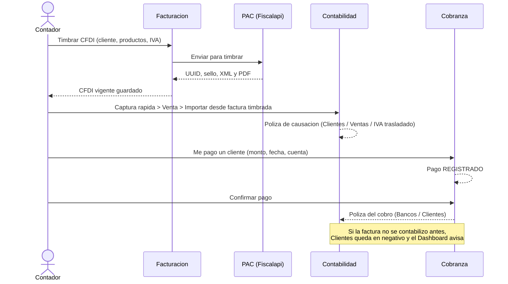
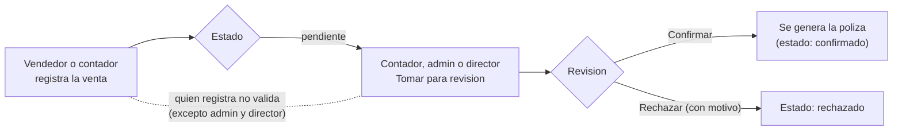
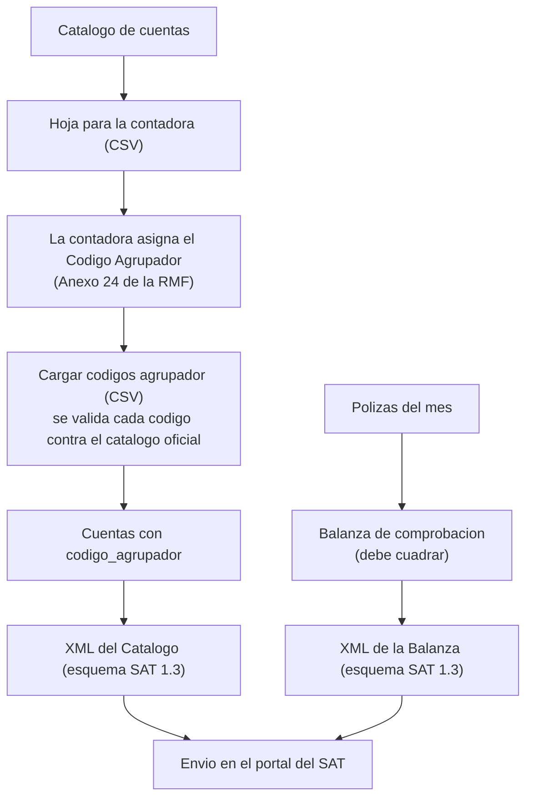
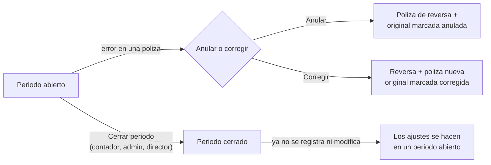
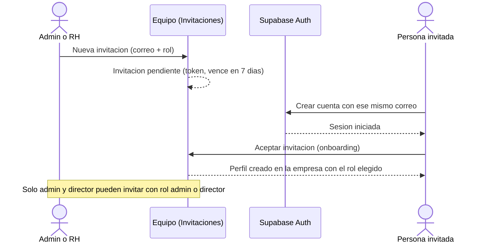

# Flujos de proceso principales (CONTATECK)

Diagramas en Mermaid (GitHub, VS Code o https://mermaid.live para exportar imagen).

## 1. De la factura al cobro (facturación, contabilidad y cobranza)

## 2. Venta (pago recibido) con revisión

## 3. Contabilidad electrónica hacia el SAT

## 4. Cierre de periodo y corrección de pólizas

## 5. Alta de una persona en la empresa

